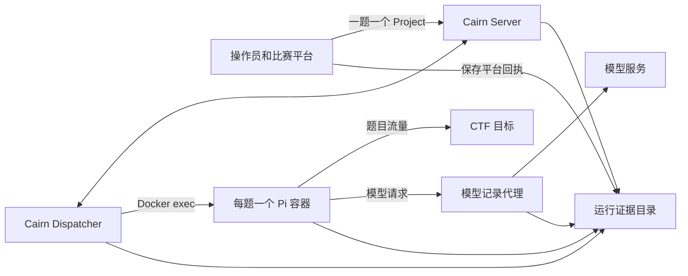

# Cairn CTF 运行与复盘

这套工具从本仓库的 `8e7e0ea67552383851dfcabfba0c4e9c8d007878` 提取上游源码，使用原版 Server、Dispatcher、默认 Prompt 和 Pi Worker。比赛部署将 Docker 镜像固定到 digest。Dispatcher 旁路记录现有 API 写入、渲染后的 Prompt、图文件与 Docker exec 字节流。Pi 通过独立的 OpenAI Chat Completions 记录代理访问模型。采集程序的代码快照、镜像标识、锁文件和 Prompt 哈希随 run 归档。



## 已实现的组件

| 组件 | 当前实现 |
|---|---|
| [比赛入口](competition.py)和 [Compose 部署](compose.yaml) | 初始化比赛目录、提取冻结的上游提交、生成 Pi 配置、启动服务、管理题目、定期采集、封存与校验。每场比赛有独立的数据库、Docker 网络和 Worker 容器名前缀。 |
| [Dispatcher 旁路采集](observe.py) | 在运行时包装原版 Dispatcher 的任务入口、API 写入和 Docker exec 流。以每次 Worker 调用为单位保存 Prompt、图快照和原始字节流，记录超时、取消和退出状态。 |
| [模型记录代理](model_recorder.py) | 转发 `POST /chat/completions`，保存请求体、上游响应体、HTTP 状态和时延。Worker 使用各自的代理凭据。 |
| [复盘索引](review.py) | 按时间合并 Dispatcher、模型和提交回执，关联调用、题目、会话及证据文件，提取 provider 返回的 usage。 |
| [本地演练](fixture.yaml) | 启动 M4-F1 服务和[确定性模拟模型](fixture.py)，用真实 Pi 走一遍工具调用与 Cairn 写回路径。 |

当前 Worker 是 Pi，默认模型是 DeepSeek `deepseek-flash`。接入官方 DeepSeek Harness（`dsh`）需要另行实现 Worker 适配器。

## 启动比赛环境

需要 Python 3.12+、Git、Linux Docker 引擎和 Compose v2。在仓库根目录执行。比赛前确认规则允许使用外部模型，并确认实际 Worker 网络能到达题目地址。默认 DeepSeek `deepseek-flash` 使用 Chat Completions，`init` 支持改模型、API base URL、上下文窗口、本地 UI 端口和并发数。

```sh
python ctf/competition.py match-01 init --workers 2 --port 8010
```

从本地秘密存储将模型密钥注入环境变量 `CTF_PROVIDER_KEY`，再启动。密钥进入模型代理容器的环境，Worker 配置只收到代理的临时凭据。首次启动会构建应用镜像，Worker 镜像由 Cairn 首次派发时拉取。

```sh
python ctf/competition.py match-01 start
python ctf/competition.py match-01 project /path/to/challenge.json
python ctf/competition.py match-01 watch --interval 120
```

`project` 接收含 `title`、`origin`、`goal` 的 JSON，可选 `bootstrap_enabled` 和 `hints`，创建成功后返回 `proj_001` 一类的 ID。也可在 `http://127.0.0.1:8010` 的原版 UI 建题。命令行入口还会保存原始建题 JSON 和 API 回执。`origin` 写入允许访问的题目地址和附件下载位置。附件需要由 Worker 从可访问的位置取得，当前命令没有附件上传功能。

`watch` 在独立终端运行，定期做 SQLite 在线备份并收集题目容器、日志和 Pi 会话。`snapshot` 只采集一次。周期快照会重复保存工作目录，间隔按题目产物大小设置。

## 记录成绩并封存

通过比赛允许的方式提交 flag，再将平台实际回执保存为 JSON，至少包含布尔字段 `accepted`。可同时填 `submitted_at`（含时区的 ISO 8601）、`challenge_id`、`platform_response` 和 `evidence_ref`。`evidence_ref` 可指向工具输出、工作文件或 Fact。平台判定与 Cairn 的 `completed` 分别留存。

```sh
python ctf/competition.py match-01 submission proj_001 /path/to/receipt.json
python ctf/competition.py match-01 stop-project proj_002
python ctf/competition.py match-01 finish
python ctf/competition.py match-01 verify
```

`stop-project` 用于仍在运行的题。收尾前按 Ctrl+C 结束 `watch`，等所有题进入 `stopped` 或 `completed`。`finish` 等 Cairn 停止本场 Worker 容器，停止采集进程，抓最终 SQLite、图和 timeline，生成 `index.json` 并逐文件校验。停止的 Worker 容器和赛中归档均保留供排查。原始内容可能含 flags、题目数据和服务回显，复盘目录应放在仅团队可访问的位置。对外分享前先检查和脱敏。

## 证据目录与复盘路径

进入 `ctf/runs/<run-id>/evidence/`，从 `index.json` 的 `final_checkpoint` 找最终快照。按 `project_id` 筛选 `timeline.jsonl`，用 `source` 和 `artifacts` 回查原始证据。

- `manifest.json` 记录上游提交、镜像 digest、依赖锁和 Prompt 哈希。`starts.jsonl` 记录成功启动时的应用镜像 ID，归档的 `dispatch.json` 遮盖代理凭据。带凭据的运行配置在 `evidence/` 之外。
- `projects/<project_id>/` 保存用命令行入口创建的题目输入和 API 回执。
- `dispatcher/events.jsonl` 记录 Cairn API 写入请求和结果、Worker 阶段、Intent、Docker exec ID、退出和取消原因。`dispatcher/workers/` 保存每次执行的 Prompt、原始 stdout/stderr，`dispatcher/graphs/` 保存实际交给 Worker 的图快照。
- `model/events.jsonl` 记录模型状态、字节数、时延和中断。`model/<call_id>/` 保存请求体和响应体；时间线从 JSON 或 SSE 响应提取 provider 给出的 usage。请求按 Worker、容器 IP 和执行时间窗关联。遇到并发歧义或启动探针时，时间线标为 `ambiguous` 或 `unattributed`。
- `checkpoints/` 保存一致性 SQLite、服务日志，以及每题会话、Prompt 图和工作目录 tar。最终检查点还包含原版 `graph.yaml` 和 `timeline.txt`。工作目录 tar 来自题目容器，复盘时按不可信归档处理。
- `submissions/` 保存手工导入的平台回执。`index.json` 保存文件大小、SHA-256 和封存时发现的采集缺口。各次快照自己的缺口见其 `checkpoint.json`。

复盘一面 flag 时，先用 `submission_receipt` 找平台回执和题目 ID，再从最终 `graph.yaml` 找写回 flag 的 Fact 和来源 Intent。时间线中的 `worker_invocation` 可以把该 Intent 关联到执行阶段、会话和原始输出。模型事件的 `call_id` 指向请求和响应原文，可对照工具结果看模型当时看到了什么。

证据覆盖取决于各数据源实际落盘的内容。强杀前尚未到达采集器的字节无法恢复，周期快照里的活跃会话可能只含前缀。模型代理记录模型 API，题目网络报文目前只在工具输出或 Worker 自行保存的文件中可见。`verify` 校验封存后的文件集合和哈希，采集完整性需另外查看缺口记录。

## 无真实模型演练

`--fixture` 增加本地 `m4f1` 服务和确定性模型接口。Pi 仍由原版 Cairn 执行，模拟接口会让 Pi 发起一次 `bash` 工具调用，再从工具结果生成 Cairn 的完成记录。运行时清除 `CTF_PROVIDER_KEY`，模型请求只送往本地模拟服务。

```sh
python ctf/competition.py dry-run init --fixture --workers 1
python ctf/competition.py dry-run start
python ctf/competition.py dry-run project ctf/m4f1-project.json
python ctf/competition.py dry-run snapshot
# 在 UI 确认题目已完成，或通过 stop-project 演练中途终止
python ctf/competition.py dry-run finish
python ctf/competition.py dry-run verify
```

演练时从最终 Fact 反查 `fixture-evidence.json`、Pi 的工具调用和对应模型响应。用另一个 run ID 演练中途停止，再检查是否能找到已落盘的流、取消结果和采集缺口。连接真实模型时还要做一次短题，验证实际提供方、模型和 Pi 版本的工具调用兼容性。

## 验证状态

| 范围 | 状态 |
|---|---|
| 初始化与配置 | 已执行 `init --fixture`，生成的 Dispatcher 配置通过原版 `DispatchConfig` 加载，Compose 配置通过 `docker compose config --quiet`。 |
| 本地组件 | 用样本验证了 SQLite WAL 在线备份、Worker 字节流增量落盘、时间线关联、usage 提取及文件篡改检测。模型代理通过模拟上游 HTTP 响应验证了 SSE 转发和归档。 |
| Docker 端到端演练 | 当前环境的 Docker Linux 引擎未连通，尚未完成 M4-F1 容器演练和中途终止演练。 |
| 真实模型 | 当前组合尚未跑通真实模型下的工具调用、续接和收尾。 |
